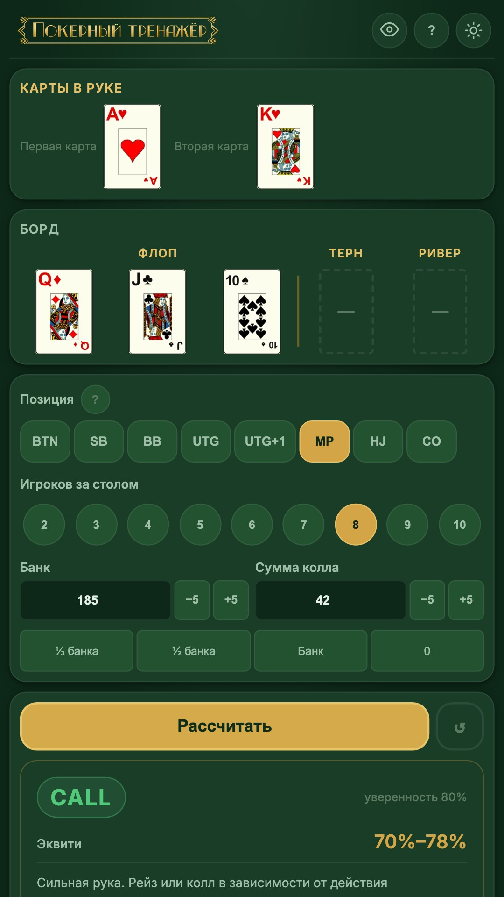

# Poker Trainer SR (Покерный тренажёр СР)

[](https://github.com/surge7/poker-assistant/actions/workflows/ci.yml)

Offline poker hand trainer and advisor: enter your hole cards, the board and
the table context — get instant equity, outs, pot-odds math and a reasoned
action recommendation (fold / check / call / raise). Runs entirely on-device:
no account, no network calls, no analytics.

Interface languages: **Russian** and **English**.



## Features

- **Hand evaluation** — 5–7 card evaluator, nuts comparison, hand rankings reference.
- **Monte-Carlo equity** — simulated against opponent ranges (VPIP-based profiles: nit, TAG, loose, maniac), not random cards; runs in a Web Worker so the UI never freezes, with a synchronous fallback.
- **Outs & odds** — outs counting (flush / straight / overcards), Rule of 2/4, pot odds, required equity, implied odds for set-mining and strong draws.
- **Context-aware advice** — street, position, pot size, bet-to-call, number of players and opponent types feed a recommendation with a color-coded reliability label and a plain-language explanation.
- **Hand history persistence** — state survives reloads (localStorage, schema-validated).
- **Themes** — dark/light, reduced-motion support, haptic feedback on Android.
- **Fully offline** — a single static bundle; the Android app loads no external content.

## Repository layout

```
packages/core/   @poker/core — pure TypeScript poker logic (no UI, no network)
apps/app/        Vite + Capacitor app (web + Android), Playwright e2e tests
docs/            build/deploy guides, strategy alignment notes, design specs
.github/         CI workflow (unit, typecheck, lint, e2e, Android APK)
```

## Quick start

Prerequisites: Node.js 22+ (see `.nvmrc`) and npm.

```bash
npm install        # installs all workspaces
npm run dev        # start the web app (Vite dev server)
```

## Testing

```bash
npm test -w @poker/core -- --coverage   # core unit tests + coverage thresholds
npm test -w app                        # app unit tests (happy-dom)
npm run typecheck                      # tsc --noEmit for all workspaces
npm run lint                           # ESLint 9
npm run build                          # build core + app first (e2e needs dist/)
npm run test:e2e -w app                # Playwright e2e (chromium, Pixel 5)
```

CI runs all of the above on every push/PR to `main` and also assembles a
debug Android APK (artifact attached to the run).

## Building

- **Web** — `npm run build`, then deploy `apps/app/dist/` to any static host.
- **Portable single file** — `npm run build:single-html -w app` produces a
  self-contained `poker-assistant.html` with an inlined equity fallback.
- **Android** — `npm run android:apk -w app` (debug) or see
  [docs/building.md](docs/building.md) for Android Studio, release signing
  and store publishing guides (RuStore, Google Play).

## How the advice engine works

The strategy logic is mapped against classic poker literature (Sklansky,
Harrington, pot-odds primers, Rule of 2/4) — see
[docs/STRATEGY_ALIGNMENT.md](docs/STRATEGY_ALIGNMENT.md) for a formula-by-formula
comparison. It is a training aid, not a solver.

## Assets & credits

- Card faces are generated from the public-domain
  [SVGCards](https://github.com/saulspatz/SVGCards) deck (Horizontal2).
- Fonts: [Inter](https://rsms.me/inter/) (SIL Open Font License 1.1).

## License

Code is released under the [MIT License](LICENSE). Fonts remain under their
own SIL OFL 1.1 license.

## Disclaimer

This trainer is for education and practice. It does not guarantee winnings and
is not advice for real-money play. Play responsibly.
